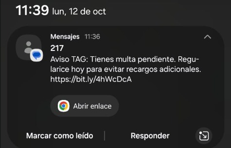
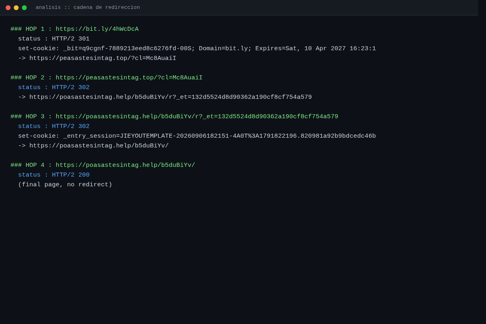
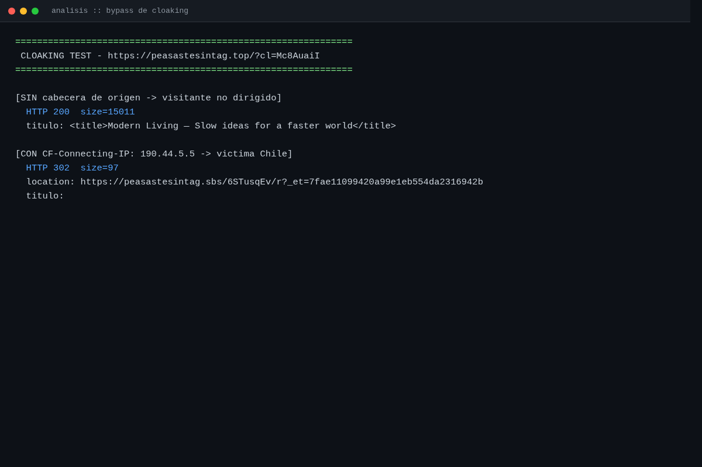
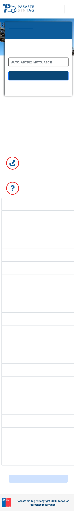
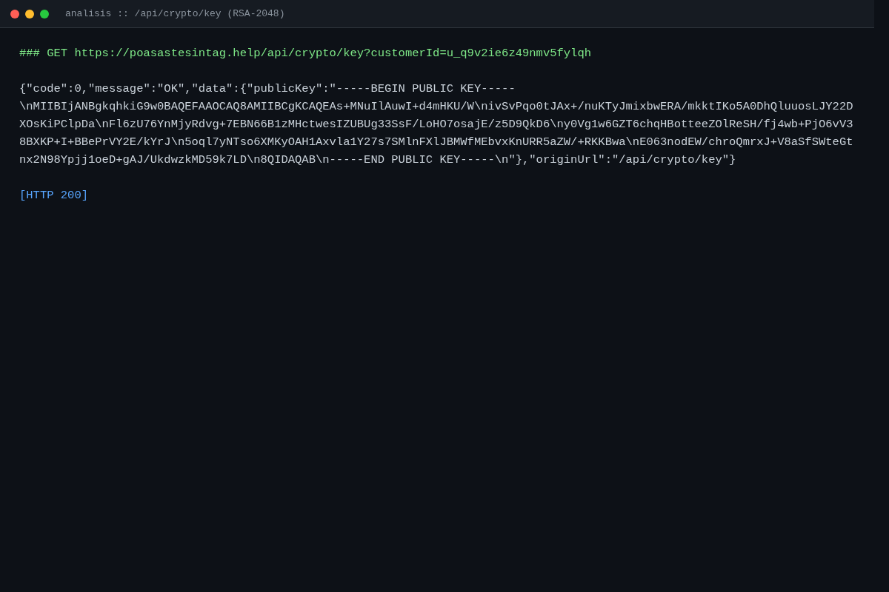
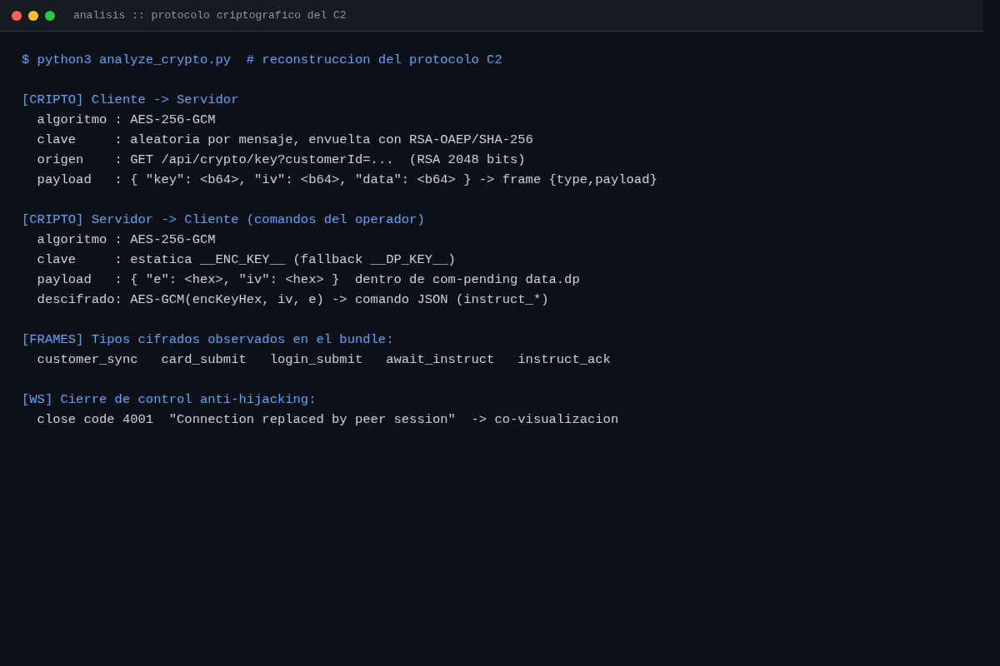
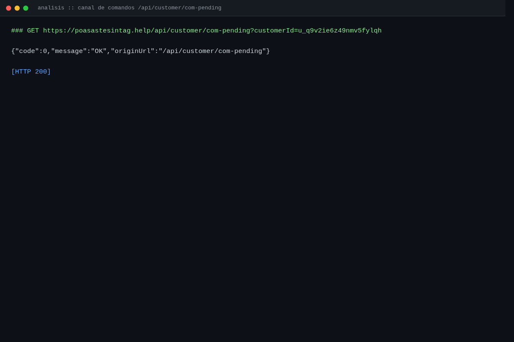
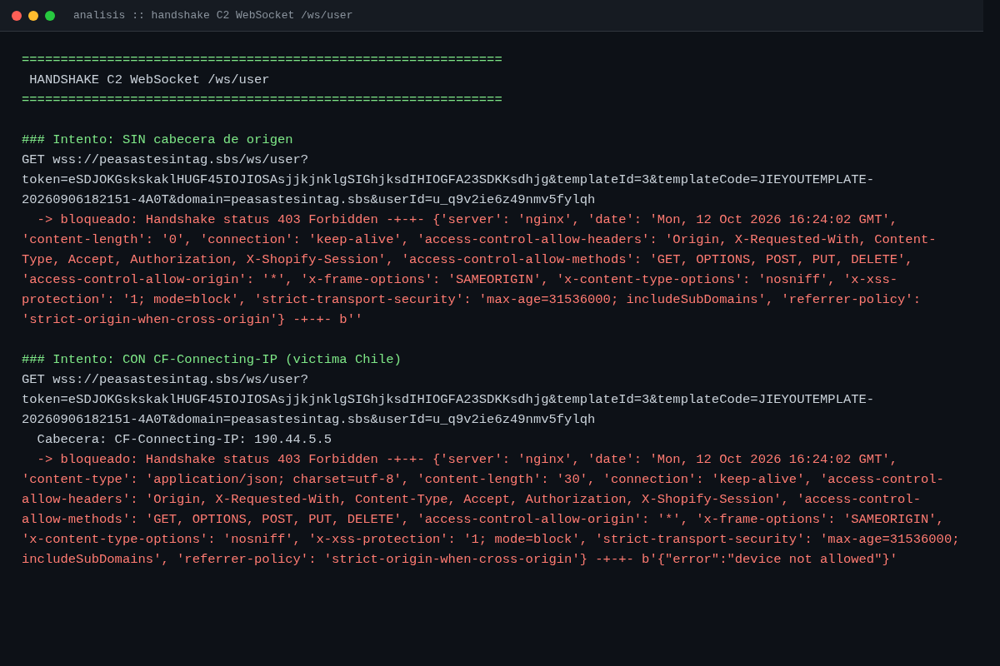
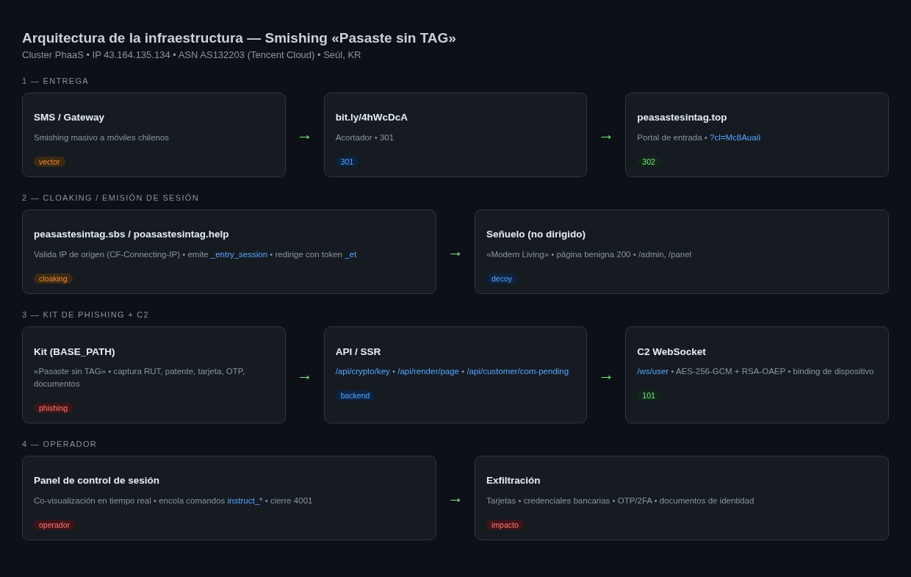
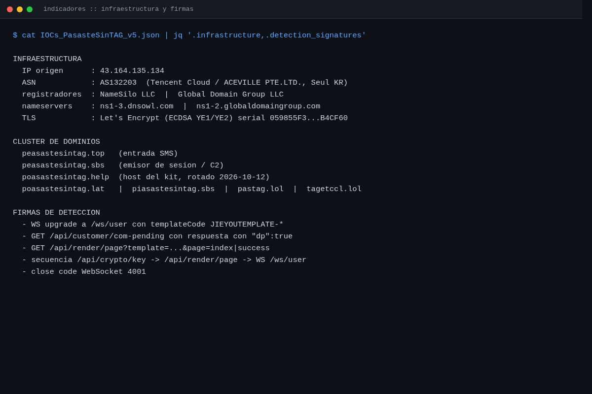

# Campaña de Smishing «Pasaste sin TAG» (Chile)

## Análisis de infraestructura, kit PhaaS y canal de comando y control

**Clasificación:** TLP:AMBER
**Fecha de análisis:** 2026-10-12
**Tipo de informe:** CTI técnico / indicadores de compromiso
**Origen de la muestra:** SMS con enlace `hxxps[:]//bit[.]ly/4hWcDcA`
**Sector objetivo:** Usuarios de peajes y TAG en Chile (suplantación de concesionarias / MOP)

---

## 1. Resumen ejecutivo

Se analizó una campaña de smishing dirigida a usuarios chilenos bajo el pretexto de un supuesto
tránsito impago en autopista («Pasaste sin TAG»). El enlace distribuido por SMS conduce a un clúster
de infraestructura que combina **cloaking por IP de origen**, **emisión de sesión de víctima** y un
**kit de phishing tipo PhaaS** con un canal de comando y control (C2) en tiempo real.

El análisis permitió reconstruir íntegramente:

* la **cadena de redirección** de extremo a extremo y el mecanismo de cloaking;
* la **emisión y el formato de la cookie de sesión** de víctima;
* el **backend HTTP** (API de cifrado, renderizado de páginas en servidor y canal de comandos);
* el **protocolo criptográfico** del canal WebSocket (AES-256-GCM + RSA-OAEP/SHA-256);
* el **modelo operativo** de un panel de control de sesión humano con co-visualización en vivo.

La infraestructura se sirve desde una **única dirección IP** (punto único de fallo) y opera sobre un
**clúster de dominios de vida corta** registrados en `NameSilo` y `Global Domain Group`, con
certificados `Let's Encrypt` reutilizados entre dominios.

> Este documento es material defensivo. Su objetivo es permitir el **bloqueo, la detección y la
> atribución** de la campaña por parte de equipos de seguridad y proveedores.

---

## 2. Cadena de entrega y redirección

El vector de entrega es un SMS masivo que suplanta una notificación de tránsito impago y conduce
al enlace acortado objeto del análisis:



*Figura 1. Mensaje SMS del atacante tal como llega a la víctima, con el enlace acortado
`hxxps[:]//bit[.]ly/4hWcDcA` que inicia la cadena de redirección.*

El enlace del SMS pasa por varias capas antes de llegar al contenido. La cadena capturada es una
secuencia de **redirecciones 301/302** con inyección de un token de entrada (`_et`) y de una cookie
de sesión (`_entry_session`):

```
bit[.]ly/4hWcDcA
   └─ 301 ─> peasastesintag[.]top/?cl=<afiliado>
              └─ 302 ─> <host-cloaking>/<BASE_PATH>/r?_et=<32 hex>
                         └─ 302 + Set-Cookie: _entry_session=JIEYOUTEMPLATE-…:<epoch>.<hmac>
                            └─ 200 ─> kit de phishing
```



**Observaciones:**

* El parámetro `cl=Mc8AuaiI` identifica al **afiliado** que distribuye el tráfico (modelo de reparto
  de campañas).
* El token `_et` es de **un solo uso** y se consume al resolver la redirección.
* La cookie de sesión tiene el formato `JIEYOUTEMPLATE-<id>:<epoch>.<32-hex-HMAC>` y se emite en la
  respuesta que redirige a la ruta del kit.

---

## 3. Cloaking y emisión de sesión

El clúster discrimina a los visitantes **por IP de origen**, lo que constituye una debilidad de
diseño (la decisión se basa en cabeceras no confiables). Un visitante no dirigido recibe una página
señuelo benigna; una petición que presenta una **IP de origen chilena** (`CF-Connecting-IP`) recibe
la redirección al kit activo.

| Escenario | Resultado |
|---|---|
| Sin cabecera de origen | `HTTP 200` — señuelo «Modern Living» |
| Con `CF-Connecting-IP: 190[.]44[.]5[.]5` | `HTTP 302` — redirección al kit + `_et` |

Las cabeceras `True-Client-IP` y `X-Client-IP` producen el mismo efecto.

> El valor `190[.]44[.]5[.]5` es una **dirección sintética generada aleatoriamente** dentro de un
> rango residencial chileno con fines de prueba del disparador de cloaking; no corresponde a
> ninguna víctima real ni al origen del análisis.



---

## 4. Señuelo (dominio de encubrimiento)

Ante un visitante no dirigido (o ante las rutas `/admin` y `/panel`), el clúster sirve una plantilla
benigna de apariencia editorial, sin ningún contenido de phishing. Esta página actúa como capa de
encubrimiento frente a revisores, rastreadores y analistas.


Plantillas señuelo observadas durante el periodo de análisis:

* «Modern Living — Slow ideas for a faster world»
* «Dev Notes — Engineering thoughts & build logs»
* «Studio Works — Design notes from a small independent studio»

---

## 5. Kit de phishing

El contenido real de la campaña es una landing en español titulada **«Pasaste sin TAG»**, orientada a
la captura de datos de tránsito y pago. La página se sirve mediante el **backend de renderizado en
servidor** (`/api/render/page`), por lo que su contenido es **remotamente mutable** sin necesidad de
cambiar el enlace distribuido.



Datos que el kit está diseñado para capturar:

* patente / placa del vehículo y RUT;
* datos de tarjeta (número, vencimiento, CVV, titular, PIN);
* credenciales bancarias y códigos OTP / 2FA;
* documentos de identidad (cédula, pasaporte, documentación de empresa).

Adicionalmente, el kit realiza **huella del dispositivo** y geolocalización mediante proveedores
externos (`get[.]geojs[.]io`, `ipwho[.]is`, `ua-parser-js`), y levanta una conexión WebSocket hacia el C2.

---

## 6. Backend HTTP

El kit expone una superficie de API que sostiene el ciclo de vida de la sesión de víctima.

| Endpoint | Función |
|---|---|
| `GET /api/crypto/key?customerId=` | Entrega la **clave pública RSA-2048** por sesión (para envolver la clave AES) |
| `GET /api/render/page?template=&page=&cid=` | Renderiza la página de phishing en el servidor |
| `GET /api/customer/com-pending?customerId=` | Sondeo de **comandos pendientes** del operador |
| `POST /api/customer/com-ack` | Confirmación de comando procesado |
| `POST /api/customer/submit` | Envío de datos del formulario |
| `POST /api/customer/state-sync` | Sincronización de estado de la sesión |
| `POST /api/customer/upload` | Subida de documentos capturados |
| `GET /api/ws/reconnect-nonce` | Nonce anti-replay para reconexión del WebSocket |

La clave pública se entrega en formato PEM estándar y varía por campaña/afiliado:



**Páginas renderizadas en servidor:** `index` (landing) y `success` (confirmación). Los pasos de
tarjeta, login y OTP **no** se sirven por esta vía: se generan en el cliente o los **inyecta el
operador en tiempo real** mediante comandos.

---

## 7. Protocolo criptográfico del canal de control

El canal de control emplea un esquema híbrido para proteger la información sensible durante su
tránsito.



**Cliente → servidor (datos sensibles):**

* Algoritmo: **AES-256-GCM**.
* Clave: aleatoria por mensaje, **envuelta con RSA-OAEP / SHA-256**.
* Material de clave: `GET /api/crypto/key?customerId=…` (RSA 2048 bits).
* Formato de frame: `{type, payload}` con `payload = {key, iv, data}` en Base64.

**Servidor → cliente (comandos del operador):**

* Algoritmo: **AES-256-GCM**.
* Clave: **estática**, embebida en el kit (`__ENC_KEY__`, con respaldo `__DP_KEY__`).
* Formato: `{e, iv}` en hexadecimal, dentro de `data.dp` de la respuesta de `com-pending`.

**Tipos de mensaje cifrados observados:** `customer_sync`, `card_submit`, `login_submit`,
`await_instruct`, `instruct_ack`.

---

## 8. Canal de comandos del operador

El kit no recibe órdenes por *push* puro del WebSocket, sino que **sondea periódicamente** un
endpoint HTTP en busca de instrucciones encoladas por el operador.



* **Sin comandos pendientes:** `{"code":0,"message":"OK","originUrl":"/api/customer/com-pending"}`
* **Con comando pendiente:** `{"code":0,"data":{"dp":true,"e":"<hex>","iv":"<hex>"}}`, cuyo
  descifrado con `__ENC_KEY__` entrega la instrucción del operador.

Códigos internos observados: `0` (OK), `20001` (parámetros faltantes / página no encontrada) y
`40001/40003/40004/40005` (fallo de sesión WebSocket que dispara reconexión).

Este diseño corresponde a un **panel de control de sesión operado por una persona**: el operador
encola comandos (solicitar OTP, tarjeta, documento, redirigir la vista) y el kit los recoge por
sondeo y los aplica en vivo.

---

## 9. Canal WebSocket (C2)

El canal de control se establece por WebSocket sobre `/ws/user`, con parámetros de plantilla y un
token de sesión. El servidor aplica **ligadura de dispositivo** y **ligadura de identidad del lado
servidor**.



**Comportamiento observado:**

* Sin cabecera de origen válida: `403 Forbidden`.
* Con cabecera de origen pero dispositivo/sesión no reconocidos:
  `403 {"error":"device not allowed"}`.

**Controles anti-abuso reconstruidos del kit:**

* Código de cierre **`4001` — «Connection replaced by peer session»**: expulsa a un cliente si dos
  sesiones comparten el mismo identificador, lo que confirma la **co-visualización de la sesión de
  la víctima en tiempo real** por parte del operador.
* **Binding de identidad server-side:** el `userId` enviado por el cliente se ignora; el servidor
  impone la identidad ligada al token/plantilla.
* **Nonce de reconexión** (`/api/ws/reconnect-nonce`) como control anti-replay.

---

## 10. Arquitectura de la infraestructura



**Detalles de alojamiento:**

* **IP de origen:** `43[.]164[.]135[.]134`
* **ASN:** `AS132203` — Tencent Cloud / ACEVILLE PTE.LTD. (Seúl, KR)
* **Registradores:** `NameSilo, LLC` (IANA 1479) y `Global Domain Group LLC` (IANA 3956)
* **Nameservers:** `ns1–3[.]dnsowl[.]com`, `ns1–2[.]globaldomaingroup[.]com`
* **TLS:** `Let's Encrypt` (intermedios ECDSA YE1/YE2), serial compartido
  `059855F3FCA9701AEABB1D87F008B8B4CF60`

Todos los dominios activos del clúster resuelven a la **misma IP**, lo que constituye un **punto
único de fallo** para la operación del atacante.

---

## 11. Indicadores de compromiso (IOCs)



> **Defang.** Todos los indicadores de red de esta sección están desfangados para su
> publicación segura: el punto se representa como `[.]` y los esquemas como `hxxps[:]//`.
> Deben re-armarse antes de usarlos en herramientas de bloqueo o detección.

### 11.1 Red

| Tipo | Valor |
|---|---|
| IPv4 | `43[.]164[.]135[.]134` |
| ASN | `AS132203` (Tencent Cloud / ACEVILLE PTE.LTD.) |
| Hosting | Seúl, Corea del Sur |

### 11.2 Dominios

| Dominio | Rol | Registrador |
|---|---|---|
| `peasastesintag[.]top` | Entrada de la cadena (post-SMS) | NameSilo |
| `peasastesintag[.]sbs` | Emisor de sesión / host C2 | — |
| `poasastesintag[.]help` | Host del kit (rotado) | — |
| `poasastesintag[.]lat` | Infraestructura secundaria | NameSilo |
| `piasastesintag[.]sbs` | Infraestructura secundaria | — |
| `pastag[.]lol` | Infraestructura secundaria | — |
| `tagetccl[.]lol` | Infraestructura secundaria | — |
| `pasastesintagclp[.]lol` | Infraestructura secundaria | Global Domain Group |

> `pasastesintag.cl` es el sitio oficial legítimo suplantado: **no** forma parte de los
> indicadores y no debe bloquearse.

### 11.3 Artefactos del kit

| Indicador | Valor |
|---|---|
| Identificador de plantilla | `JIEYOUTEMPLATE-20260906182151-4A0T` |
| Cookie de sesión | `_entry_session` |
| Parámetro de backdoor de desarrollo | `__jy_dev` |
| Claves embebidas | `__ENC_KEY__`, `__DP_KEY__`, `__ENC_SID__` |
| Identificador de afiliado | `cl=Mc8AuaiI` |

### 11.4 Archivos

* `IOCs/IOCs_PasasteSinTAG_v5.json` — indicadores estructurados v5.1 (red, DNS, TLS, cripto,
  firmas), con los valores de red desfangados.
* `IOCs/IOCs_PasasteSinTAG_v5_defanged.txt` — lista plana de indicadores desfangados,
  categorizada para su carga directa en listas de bloqueo.

---

## 12. Firmas de detección

Reglas de detección sugeridas para SIEM / IDS / proxies:

1. Upgrade WebSocket a `/ws/user` con `templateCode=JIEYOUTEMPLATE-*`.
2. `GET /api/customer/com-pending` con respuesta que contenga `"dp":true`.
3. `GET /api/render/page?template=…&page=index|success`.
4. Secuencia de peticiones `/api/crypto/key` → `/api/render/page` → WebSocket `/ws/user`.
5. Cierre de WebSocket con **código 4001**.
6. Respuesta `20001` con `originUrl: /api/render/page`.
7. Cookie `_entry_session` con valor que comience por `JIEYOUTEMPLATE-`.
8. Redirección a dominio con `?_et=<32 hex>` inmediatamente después de un parámetro `cl=`.

---

## 13. Recomendaciones de mitigación

**Bloqueo de red**

* Bloquear a nivel de DNS, proxy y correo los dominios de la sección 11.2 y la IP `43[.]164[.]135[.]134`.
* Bloquear el tráfico WebSocket saliente hacia `/ws/user` con plantillas `JIEYOUTEMPLATE-*`.

**Detección**

* Desplegar las firmas de la sección 12 en el SIEM / proxy / NDR.
* Monitorizar la secuencia de peticiones característica del kit.

**Protección del usuario final**

* Concientizar sobre SMS de peajes/tAG con enlaces acortados.
* No introducir datos de tarjeta, OTP ni documentos en sitios enlazados desde SMS.
* Ante una supuesta infracción de tránsito, verificar siempre en el sitio oficial de la concesionaria.

**Respuesta**

* Si un usuario ya ingresó datos: bloquear la tarjeta, cambiar credenciales bancarias y vigilar
  movimientos.
* Revisar la propagación del clúster por nuevas variantes de dominio en el mismo ASN.

---

## 14. Anexos

### 14.1 Estructura del repositorio

```
.
├── README.md                     # Este informe
├── IOCs/
│   ├── IOCs_PasasteSinTAG_v5.json
│   └── IOCs_PasasteSinTAG_v5_defanged.txt
├── screenshots/                  # Evidencia visual del análisis
│   ├── 01_decoy_live.png
│   ├── 02_kit_landing_ssr.png
│   ├── 03_redirect_chain.png
│   ├── 04_cloaking_bypass.png
│   ├── 05_api_crypto_key.png
│   ├── 06_api_com_pending.png
│   ├── 07_ws_handshake.png
│   ├── 08_crypto_protocol.png
│   ├── 09_iocs_cluster.png
│   ├── 10_infra_diagram.png
│   └── SMS_victima_masiva.jpeg    # Mensaje SMS del atacante (lure masivo)

└── evidencia/                    # Scripts de reproducción (PoC)
    ├── poc_kurosaki_c2_v2.py
    └── poc_kurosaki_ws.py
```

### 14.2 Glosario

| Término | Definición |
|---|---|
| **Cloaking** | Entrega de contenido distinto según el perfil del visitante |
| **PhaaS** | *Phishing-as-a-Service*: kit de phishing ofrecido como servicio |
| **C2** | *Command and Control*: canal de control del operador |
| **SSR** | *Server-Side Rendering*: renderizado de páginas en el servidor |
| **Smishing** | Phishing por SMS |
| **IOC** | *Indicator of Compromise*: indicador de compromiso |

---

*Documento técnico para equipos de seguridad y respuesta a incidentes.*
